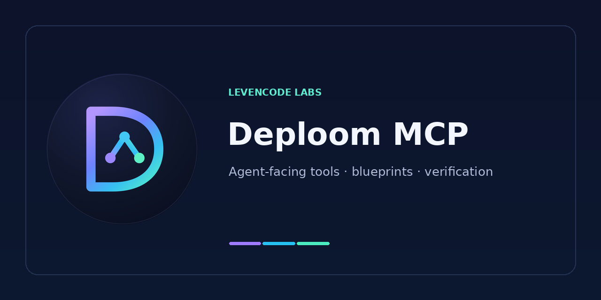

<div align="center">



# Deploom MCP

**Понятные планы обновления зависимостей для AI-агентов.**

[Levencode Labs](https://github.com/levencode-labs) · [English](README.md) · [Руководство](USERGUIDE.ru.md) · [Документация](docs/INDEX.ru.md) · [Релизы](https://github.com/levencode-labs/deploom-mcp/releases)

</div>

Deploom MCP связывает движок планирования зависимостей с MCP-совместимыми агентами. Вместо непрозрачной рекомендации «обнови пакеты» он показывает допустимую область изменений, варианты версий, ограничения совместимости и то, какие доказательства ещё отсутствуют.

Опубликованный wheel содержит **точно закреплённый [Deploom Core](https://github.com/levencode-labs/deploom-core)**, схемы и канонический Skill `deploom-upgrade`. Для его использования не нужны Electron/Desktop или отдельная установка Core.

## Возможности

- **Выбор маршрута:** `get_project_capabilities` читает локальные входы проекта и показывает доступные пути и недостающие настройки хоста без сети и запуска команд. Этот ответ не даёт права на выполнение.
- **Планирование:** `get_upgrade_plan` создаёт Upgrade Blueprint с целями, разрешёнными изменениями, ограничениями и неизвестными.
- **Разбор решений:** `evaluate_assignment` и `explain_conflict` помогают понять существующее предложение; они не выполняют миграцию и не пересчитывают произвольный новый вариант.
- **npm workspaces:** инвентаризация и ограниченное совместное планирование имеют собственные условия, покрытие и границы. Найденный workspace сам по себе не означает разрешение на его изменение.
- **Skill для агента:** `deploom-upgrade` описывает preflight, работу с планом, изолированные изменения, проверки и evidence-отчёт.
- **Отдельный путь выполнения:** поддерживаемые standalone npm-цели могут проходить host-authorized verification и финальную фиксацию результата — только в пределах [матрицы поддержки](docs/GOAL_EXECUTION_SUPPORT.md).

**`PLANNING_ONLY` / `NOT_VERIFIED` — это предложение, а не готовое обновление.** Успешный lockfile, `npm ci`, проверки фактического дерева, тесты и runtime дают разные доказательства.

## Быстрый старт

1. [Установите релизный wheel и при необходимости Skill](USERGUIDE.ru.md#1-установите-релиз).
2. [Подключите MCP-клиент](USERGUIDE.ru.md#3-подключите-mcp-клиент): [Codex](integrations/codex/README.md), [OpenCode](integrations/opencode/README.ru.md) или [Claude Code](integrations/claude-code/README.md).
3. Начните с **PLAN_ONLY** на открытом или синтетическом проекте и изучите настоящий Blueprint.
4. Для изменения проекта отдельно разрешите работу в изолированной копии и независимую проверку.

Для сетевого подключения см. [HTTP deployment](docs/HTTP_DEPLOYMENT.md). По умолчанию сервер работает через **stdio**. Встроенной аутентификации и изоляции пользователей в HTTP нет: публичный доступ требует защищённого gateway и отдельных экземпляров для недоверенных клиентов.

## Разработка из исходников

Пакет объявляет Python **`>=3.12,<3.15`**; для первой проверки рекомендуется **Python 3.12**. Некоторые зависимости имеют платформенные wheel.

```bash
git clone https://github.com/levencode-labs/deploom-mcp.git
cd deploom-mcp
git submodule update --init --recursive
python -m venv .venv
# Активируйте виртуальное окружение или вызывайте его Python явно.
python -m pip install -e .
python -m deploom_mcp
```

Последняя команда запускает stdio MCP-сервер и не открывает веб-интерфейс. Для повторяемой проверки опубликованного пакета используйте [руководство](USERGUIDE.ru.md). Gitlink Core закреплён: косметические изменения не должны менять его без отдельной проверки.

## Документация

| Раздел | Ссылка |
| :-- | :-- |
| Установка и первая проба | [Руководство](USERGUIDE.ru.md) · [English](USERGUIDE.md) |
| Контракты и архитектура | [Индекс](docs/INDEX.ru.md) |
| Процесс агента | [Skill](skills/deploom-upgrade/SKILL.md) |
| Границы выполнения | [Goal execution](docs/GOAL_EXECUTION_SUPPORT.md) |
| HTTP и безопасность | [HTTP deployment](docs/HTTP_DEPLOYMENT.md) |
| Установка для коллег | [Как передать Deploom](docs/SHARING_WITH_COLLEAGUES.ru.md) |

**Релиз-ориентир:** [`v0.2.11`](https://github.com/levencode-labs/deploom-mcp/releases/tag/v0.2.11) был последним опубликованным релизом на 8 ноября 2026 года. Проверяйте [новые релизы](https://github.com/levencode-labs/deploom-mcp/releases/latest). Ускорение миграции и качество на любых проектах не считаются доказанными без независимого сравнения и выполнения необходимых проверок.
